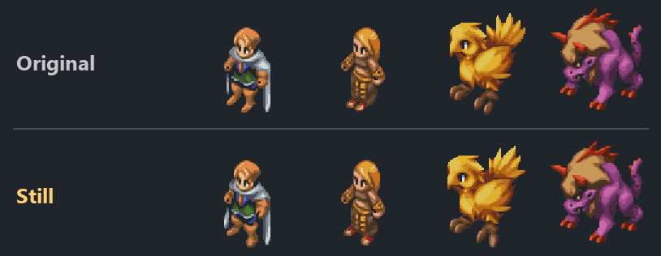

# Idle Animations: Still & Breathing

A [Reloaded-II](https://github.com/Reloaded-Project/Reloaded-II) mod for **FINAL FANTASY TACTICS – The Ivalice Chronicles** (Classic and Enhanced).

In the original game, every unit in battle constantly walks in place while it waits for its turn. This mod replaces that loop: units stand still, the way they already do in the game's own story scenes, or, in the experimental version, stand and breathe.



## Versions

Pick **one**:

| Version | Humans | Monsters, chocobos | Altima forms |
|---|---|---|---|
| **Still (Everyone)** (main, recommended) | Still | Still | Still |
| **Still (Humans)** | Still | Original idle | Original idle |
| **Breathing** (experimental) | Breathe | Breathe | Original idle |

Download the zips from the [Releases](../../releases) page.

## Installation

1. Install **Reloaded-II** and the **[FFT: The Ivalice Chronicles Mod Loader](https://github.com/Nenkai/fftivc.utility.modloader)** by Nenkai (built and tested with 1.7.5), and add the game's executables to Reloaded-II.
2. Download **one** version. Drag the zip onto the Reloaded-II window, or extract the folder inside it into Reloaded-II's `Mods` folder.
3. Select the game (`fft_enhanced.exe` and/or `fft_classic.exe`) and tick **Idle Animations: …**. Classic and Enhanced are separate applications in Reloaded-II, so enable it for each mode you play.
4. Start the game through Reloaded-II.

To uninstall, untick the mod (for each mode) and restart the game; delete its folder from `Mods` to remove it completely. The mod never modifies the game's own files, and save files are not affected.

## Manual

The manual explains how idle animations work in the game, the different body types, exactly what the mod changes, how it was made, troubleshooting and known issues. It ships inside every download as `IdleAnimations_Manual_en.html` and `IdleAnimations_Manual_ru.html`. The sources are [docs/manual_src.html](docs/manual_src.html) (English) and [docs/manual_src_ru.html](docs/manual_src_ru.html) (Russian).

## Building from source

The mod is generated by Python scripts from the game's own unit animation files. **No game files are included in this repository**; you extract them from your own copy of the game.

Requirements:
- Python 3 with [Pillow](https://pypi.org/project/pillow/) (`pip install pillow`)
- [FF16Tools](https://github.com/Nenkai/FF16Tools) by Nenkai, to unpack the game's archives
- For previews and manual figures only: sprite sheets exported with the FFT Ivalice Chronicles Sprite Modding Toolkit, in `extracted_sprites/`

Steps (from the repository folder):

1. Unpack the unit files from the game's `data\enhanced\0002.pac` into `unpacked\` so that they end up in `unpacked\fftpack\unit\`:
   ```
   FF16Tools.CLI unpack-all -i "<game folder>\data\enhanced\0002.pac" -o unpacked -g fft
   ```
2. Build the three versions into `mods\` and check them against the originals:
   ```
   python tools\build_mods.py unpacked\fftpack\unit mods
   python tools\verify_mods.py unpacked\fftpack\unit mods
   ```
3. Optionally rebuild the manual (`python tools\build_manual.py`) before step 2, so the new manual is copied into the mods.

| Script | Purpose |
|---|---|
| `build_mods.py` | Builds all three versions. Timing, cut lines, frame slots and frame swaps are set at the top. |
| `verify_mods.py` | Compares each built file with the original and lists what changed. |
| `seq_decode.py`, `shp_render.py` | Decode the SEQ (animation) and SHP (frame layout) formats and render frames. |
| `breath.py` | Builds a breathing frame from a standing pose. |
| `render_built_idle.py`, `breath_preview_multi.py`, `compare_idle.py`, … | Previews. |
| `make_manual_figures.py`, `build_manual.py`, `make_nexus_images.py` | Manual figures, the manual itself, page images. |
| `nxd_*.py`, `find_*.py`, `memlog.ps1`, `debugcapture.ps1`, `debug_summary.py` | Research and crash diagnostics. |

## Known issues

- The game may occasionally crash (for example during a story scene or after a long time in a menu). It isn't clear yet whether this is related to the mod; see *Troubleshooting* in the manual.
- Animations are shared per body type, so every character of a type gets the same idle.
- In Breathing, all monsters share one idle: floating and limbless monsters lose their original motion.

Compatibility with other mods hasn't been tested. Any mod that replaces the `battle_*_seq.bin` / `battle_*_shp.bin` unit files conflicts with this one. Please open an issue if you run into problems.

## Credits

- **Nenkai**: FF16Tools and the FFT: The Ivalice Chronicles Mod Loader.
- **The Reloaded-II project**: the mod manager.
- **Glain, melonhead and the FFTPatcher contributors**: ShishiSpriteEditor, whose source documents the SEQ and SHP formats.
- **The Final Fantasy Hacktics community**: years of documentation of the original game's files.
- **The author of the FFT Ivalice Chronicles Sprite Modding Toolkit**: sprite exports used for previews.
- Made with the help of **Claude Code** (Anthropic).

## Copyright

FINAL FANTASY TACTICS – The Ivalice Chronicles is © SQUARE ENIX. This repository contains no game files or sprite art; images in `docs/img` are renders of the game's sprites made for the manual.
